# MySQL_Chapter4
<b>Table of Content</b>
- [Summary](#summary)
- [Author](#author)
- [New Concepts Used](#list-of-new-concepts-used)
- [Console Output Example](#console-output-testing-as-images)

## Summary
This assignment is a collection of twelve multi-table queries that deal with data such as customer, 
film, rental information etc. In each query we manipulated how the data in the tables 
is displayed by using concepts listed in the following section.

## List of New Concepts Used 
- Inner Join
- Compound Join Condition
- Self-Join
- More than two tables
- Implicit Inner Join
- Left Outer Join
- Right Outer Join
- Using keyword
- Natural keyword
- Cross Join
- Union
- Full Outer Join

## console output testing as images
### Query 1
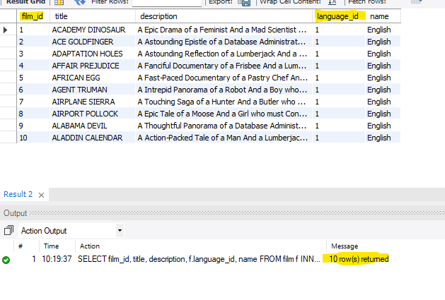
### Query 2
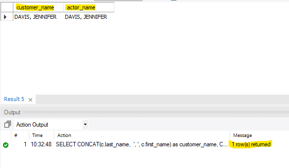
### Query 3
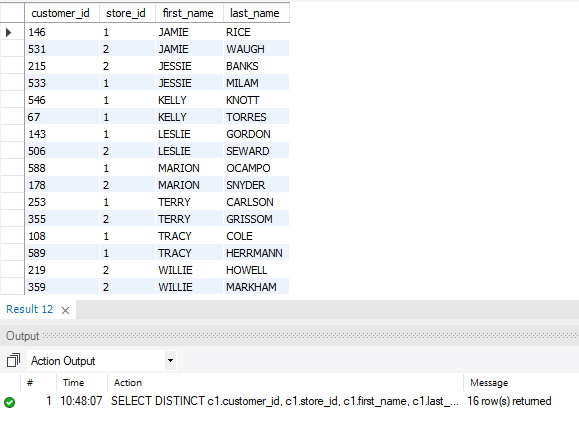
### Query 4
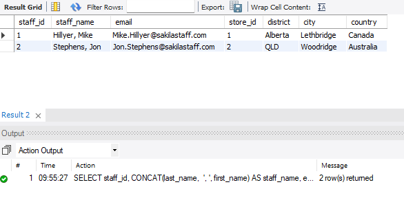
### Query 5
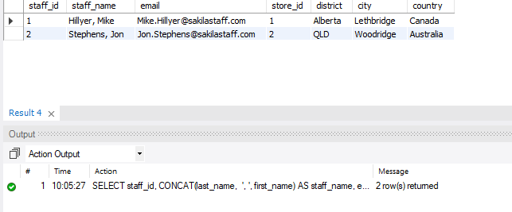
### Query 6
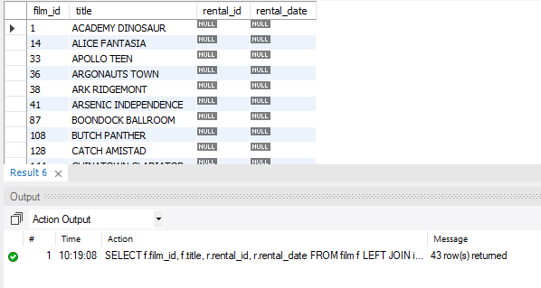
### Query 7
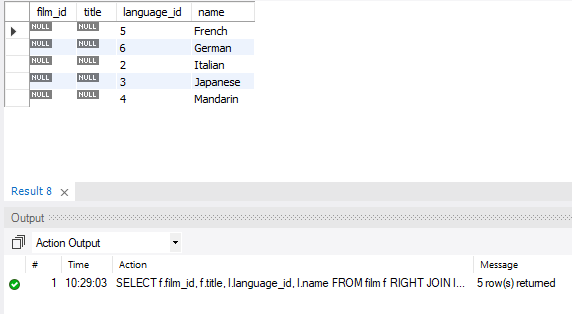
### Query 8
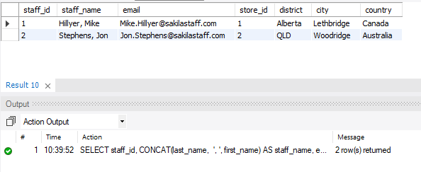
### Query 9
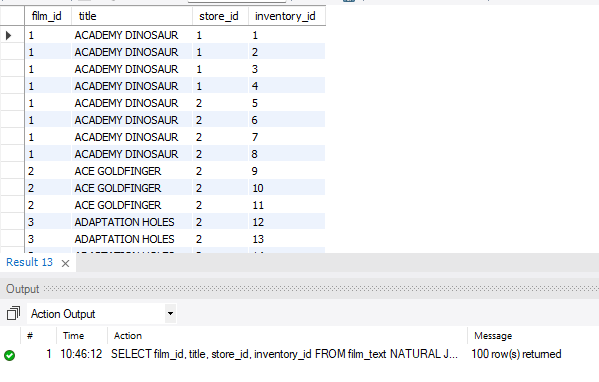
### Query 10
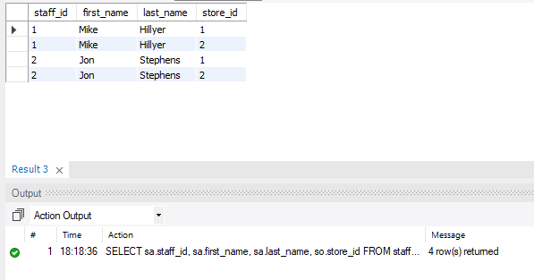
### Query 11
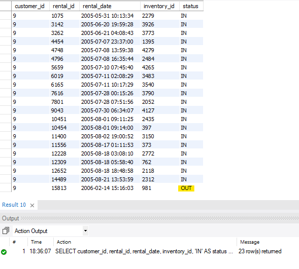
### Query 12
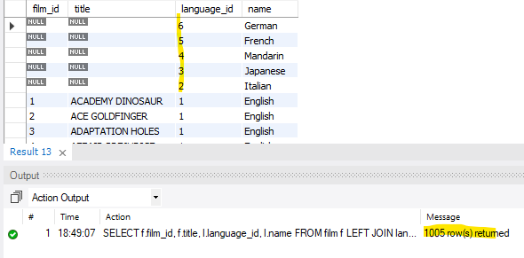

## Author
**Suna Aregay**  
GitHub: [@suna2km](https://github.com/suna2km)

